# Synchronous Animations for Aseprite
A script for **[Aseprite](https://www.aseprite.org/)** that allows the synchronization of animated layers at different paces.

You've probably animated stuff if you're here, and you may have noticed that sometimes, different parts of the animation have different speeds, making it hard to actually sync them with each other.
### How does this script solve the issue?

Lets say you have 2 animated layers. You want one to have a 500ms interval per frame, but you also want the second layer to have an interval of 250ms per frame.

The solution to this is to split each frame in the 500ms layer, into 2 identical frames of 250ms each.

These **buffer frames** allow the slower layer to keep pace with the faster one.

This script automates the process of creating buffer frames.

## 🎥 Demo

Here are 2 separately animated pieces that I would like to sync. (After putting them into a single sprite).

  
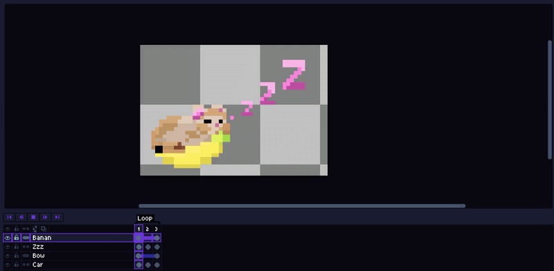 
 <i>Banana Cat animation with 3 frames in a ping-pong loop. 500ms per frame.</i>

 

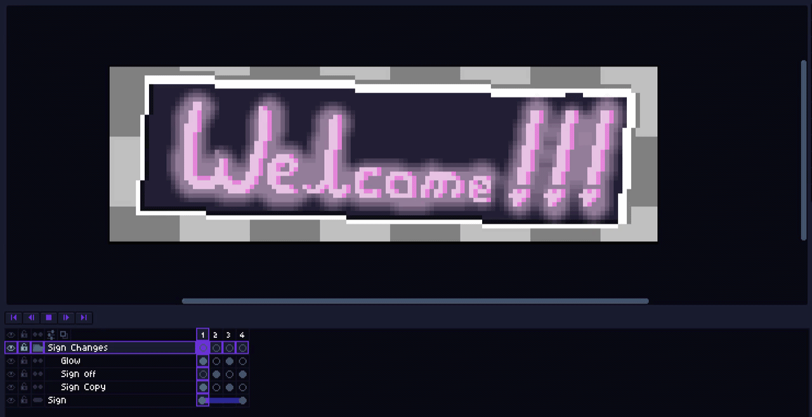 
 <i>A welcome sign animation with 4 frames.  
Frame 1 - 3000ms  
Frame 2 - 50ms  
Frame 3 - 75ms  
Frame 4 - 875ms</i>

 
Let us say we have these animations in a single sprite
 

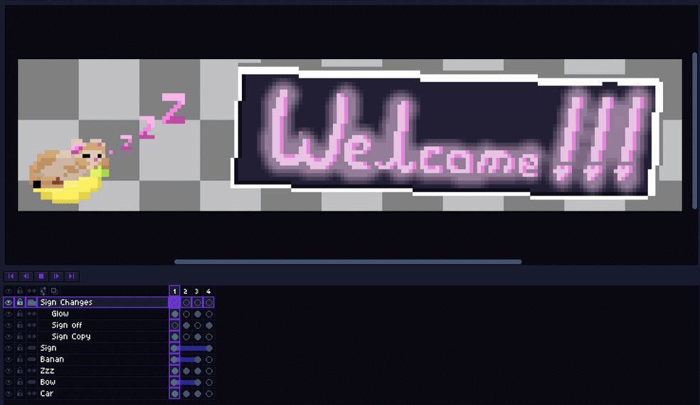 
 <i>The layers and frames have simply been replicated and are running at 500ms per frame.</i>

Currently, the animation looks very incomplete. There are 2 core issues:
1. The Banana Cat frames have an incomplete 4th frame because the original intended animation was 3 frames long.
2. If the duration of each frame were to match the original Sign animation, it would interfere with the Banana Cat's pacing.

### Using the Script:

  
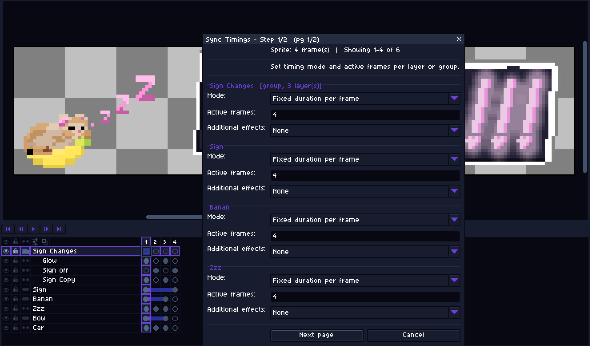 
 <i>This is the first dialogue window that pops up when you run the script.</i>

 

### Step 1

#### Note: It shows up to 4 layers on a page. If layers are encapsulated within a group, it will only show the group.

It has 3 modifiable values:
1. Mode - 

    **A.** Fixed duration per frame 

    **B.** Custom duration per frame 

    **C.** Static (The layer remains the same throughout).

2. Active Frames (This defines the frames in which the animation actually takes place).
3. Additional Effects - 

    **A.** None (Default)

    **B.** Loop (Regular looping animation throughout for that layer)

    **C.** Ping-pong (Ping-pong looping animation throughout for that layer)

For our current animation, we will be using the following values for the layers.

  
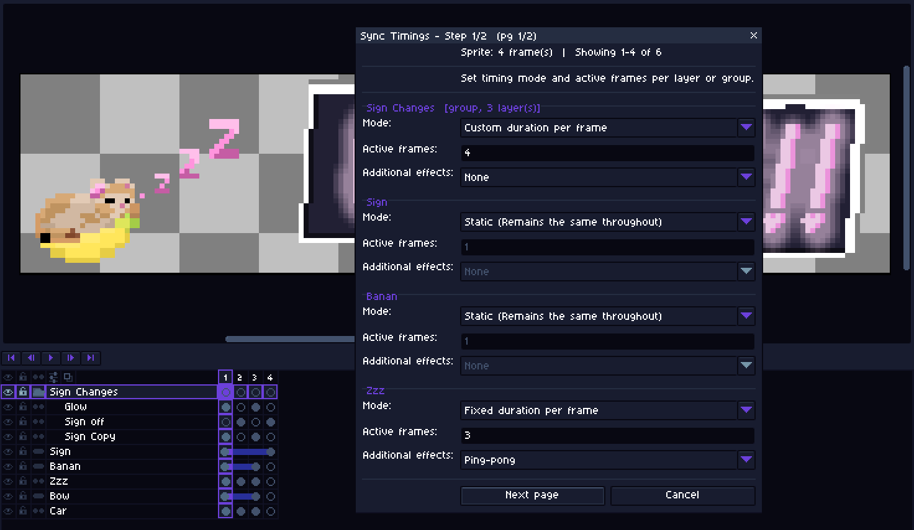
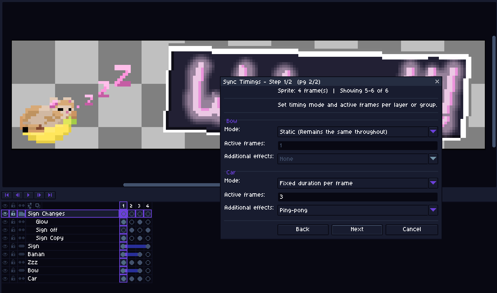 

 

We select Ping-pong for the car (cat) layer, and the Zzz (snoring) layer based on the original animation.

The static layers are the ones that have no changes throughout the animation (Bow, Sign, Banan).

The Sign Changes Group has irregular intervals for all 4 active frames.

The Car (Cat) Layer has 3 different frames but Fixed durations for each frame.

### Step 2

Here we can edit the actual values of each frame with custom durations as well as fixed durations for all frames within that layer.

  
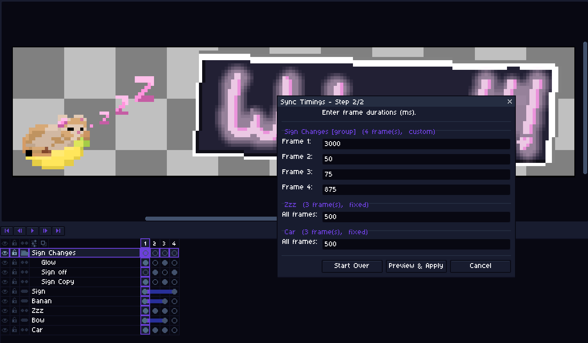 

 

Here I have inserted the values based on the original animations (as mentioned in the beginning of the demo).

### Preview

  
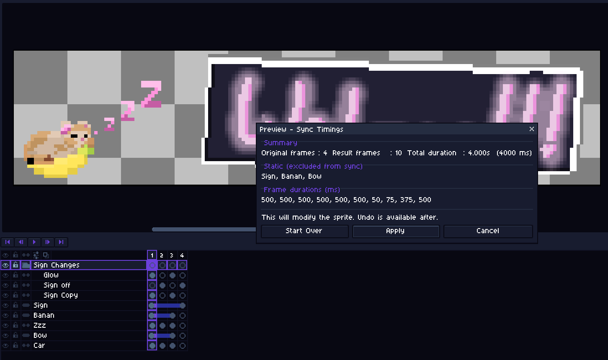 

 

Here is the preview of the what the frame durations would look like after the implementation of the script.

### Output

  
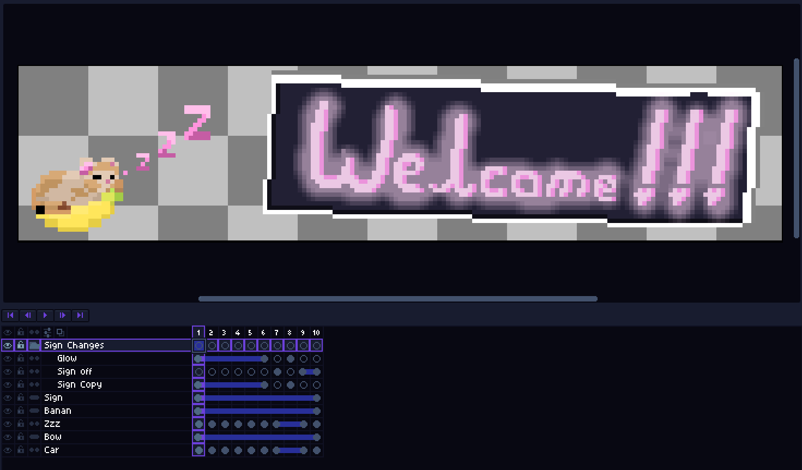 

 

Here is the output sequence of the frames in the animation, along with the animation itself below.

  
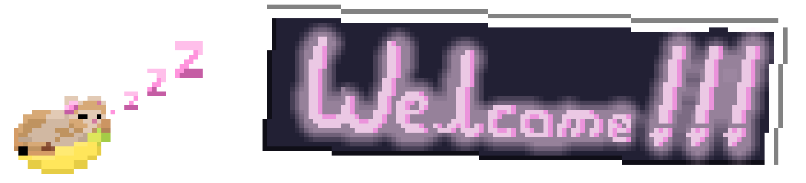 

 

## ⚠️ Be careful
>While I will be doing my best to keep this updated and introduce new possible features (feel free to offer feedback), there are always chances things might not work quite right. To be safe, **please always save/back up your files.**

## 🪳 Report a bug
Found something that's not quite working right or do you have a feature request? Don't be shy, feel free to make some noise over on the **[GitHub Issues](https://github.com/CertifiedHabibi/Synchronous-Animations-for-Aseprite/issues)** page. But be sure to check if someone has already posted the same issue and comment on theirs if they have.

## 💾 Installation

Install the latest release from **[GitHub Releases](https://github.com/CertifiedHabibi/Synchronous-Animations-for-Aseprite/releases)**

Open the scripts folder under **File > Scripts** and place the script there.

You can also set a hotkey for it in **Edit > Keyboard Shortcuts > Search: "Synchronous Animations"**
## ❤️ Support
If you find this script saves you time or helps you in some way, please consider supporting my artwork and other free community material like this.

<a href="https://bsky.app/profile/pookiepixels.bsky.social">
  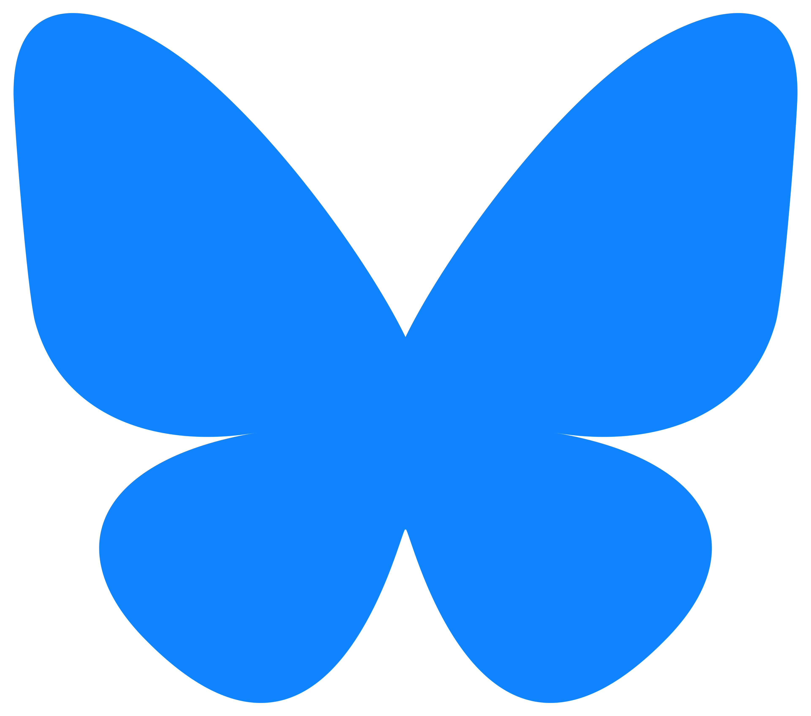
</a>

